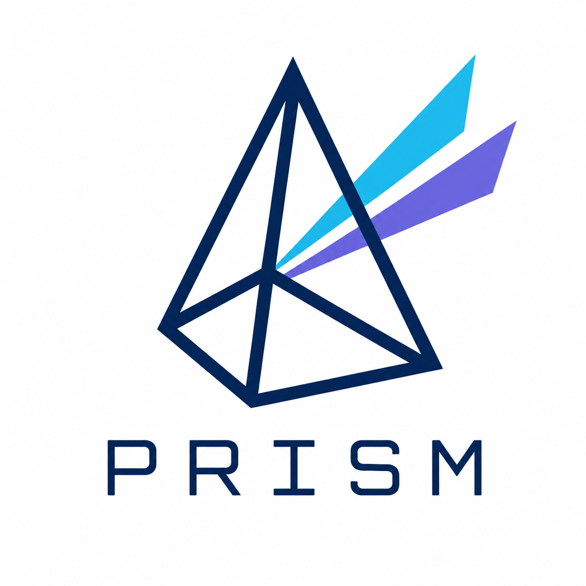

# Prism

<p align="center">
  
</p>

An agentic equity research system — a set of independent commands, each usable on its own.

---

## Setup

Prism runs inside Claude Code. One-time setup:

1. **Copy the env template** and fill in whichever keys you want (all are optional except `OPENAI_API_KEY` for `/podcast` — see the table):
   ```
   cp .env.example .env
   ```
2. **Run the setup script** — installs Python deps (`yfinance`), checks for `ffmpeg` / `gh`, and verifies every environment variable and settings file below (it loads `.env`, so it sees values configured there). Safe to re-run.
   ```
   bash setup.sh
   ```

**Environment variables** — set in `.env` (gitignored), or in your cloud sandbox's env:

| Variable | Used by | Required? |
|---|---|---|
| `OPENAI_API_KEY` | `/podcast` (TTS) | **Required** for `/podcast` |
| `NOTION_TOKEN` | `/log-trade` (write), `/scout` (read) | Optional — without it, `/log-trade` logs locally only and `/scout` skips the Notion read |
| `NOTION_INVESTMENT_LOG_DATA_SOURCE_ID` | `/log-trade` | Optional — falls back to resolving the "Investment Log" DB by name |
| `NOTION_INVESTMENT_LOG_DATABASE_ID` | `/scout`, `/log-trade` | Optional — same name fallback |
| `EDGAR_CONTACT_EMAIL` | `/scout`, `/research` (SEC EDGAR requires a contact email in the request header) | Recommended — falls back to a generic placeholder |
| `X_BEARER_TOKEN` | `/scout` (X signal source) | Optional — without it, scout runs on GDELT / HN / EDGAR |
| `SNAPTRADE_CLIENT_ID` + `SNAPTRADE_CONSUMER_KEY` | `/sync-portfolio` (brokerage read via SnapTrade Personal API key) | Optional — without them, `/sync-portfolio` runs review-only off the last committed snapshot |

**Settings files:**

- **`.claude/scout-x-feeds.json`** — the curated X accounts `/scout` pulls from (`handles[]`, optional `topics` / `note` per account). Ships as an example template; edit it with accounts you actually follow. Only used when `X_BEARER_TOKEN` is set; harmless to leave as the template otherwise.
- **Notion MCP** — `/log-trade` and `/scout` reach Notion through the MCP server wired in `.mcp.json` (`@notionhq/notion-mcp-server`, launched by `scripts/start-notion-mcp.sh`, which reads `NOTION_TOKEN` from `.env`). Create a Notion *internal integration*, copy its secret into `NOTION_TOKEN`, and share your Investment Log database with that integration. Step-by-step in `.env.example`.

**System tools:** `ffmpeg` (podcast audio stitching), `gh` (PR creation), `python3`. `setup.sh` checks for these.

---

## Two-repo workflow (optional)

Prism's outputs are personal — trades, reports, journal entries. The recommended way to run it long-term is **two sibling repos**:

- **The engine** ([prism-shared](https://github.com/justinchencya/prism-shared), public): `scripts/`, `.claude/agents/`, `.claude/commands/`, `.claude/hooks/` + `.claude/settings.json`, `CLAUDE.md`, `README.md`, `setup.sh`. Tracking files ship as empty templates.
- **Your daily driver** (a private repo): the same engine files plus your real data (`reports/`, `scouts/`, `tracking/*.json`, generated dashboard, real X follows, `.env`).

Engine changes belong in the engine repo first, then flow to the private repo; changes made in the private repo during daily use get ported back — with anything personal stripped. `/sync` (`.claude/commands/sync.md`) automates both directions: it diffs the engine file set between the sibling checkouts, infers direction per file from git history, sanitizes anything flowing into the public repo, and lands the changes as a PR in the receiving repo. Engine files stay byte-identical across the pair; only the personal data ever differs.

Single-repo use works fine too — clone, delete `.prism-engine` (the marker that stops data-writing commands from running in the public engine repo), and go. The split only matters once you have data you don't want public.

---

## Scout

```
/scout <focus>
```

Mines free signal sources for emerging themes within a direction you give it. Returns a ranked brief with suggested research questions — no research is run.

**How it works:**

1. Expands your focus into a per-source query spec (`queries.json`) — picks terms specific enough to spike (e.g. "AI inference cost" not "AI").
2. Fetches raw signals from GDELT (coverage-volume spikes), Hacker News (velocity), and SEC EDGAR (filings) — and, if configured, recent posts from a curated X follow list (engagement velocity). No LLM.
3. Clusters signals into candidate themes, checks against past reports (a fresh signal on a covered topic surfaces as a follow-on, not a duplicate), scores by relevance / novelty / researchability.
4. Writes a ranked brief.

**X source (optional):**

- **`.claude/scout-x-feeds.json`** — the accounts you follow for high-value signal (`handles[]`, optional `topics`/`note` per account). A substantive post from one of them is weighted like a fresh filing.
- **`X_BEARER_TOKEN`** — X API v2 app-only bearer token, a tier with user-timeline read (shell env or `.env`). Without the token or the file, scout runs on the free sources exactly as before.

**Output** → `scouts/YYYY-MM-DD-HHMMSS/`

- **`queries.json`** — the per-source query spec built from your focus.
- **`signals.json`** — raw normalized signals.
- **`brief.md`** — ranked candidate themes, each with a why-now rationale, a suggested research question, effort estimate, and an investable call.

Each run is committed on its own branch and opened as a Pull Request (remote `origin`, base `main`).

---

## Research

```
/research <question> [sources:<url,...>] [effort:quick|low|medium|high]
```

Refracts the question into sub-questions, researches them in parallel, iterates against a director's critique, and synthesizes a final report.

**How it works:**

1. Director decomposes the question into a two-layer question tree (`plan.md`). The director plans/critiques/synthesizes; the `/research` command itself dispatches the researcher subagents, since the director runs as a subagent and can't spawn further subagents.
2. Layer-2 items are grouped into 3–8 bundles; one researcher per bundle runs in parallel.
3. Director critiques all reports and the command re-dispatches revisions on its behalf. Rounds: `quick`=0 (no critique pass), `low`=1, `medium`=2, `high`=4 (upper bounds — director may stop earlier).
4. If the question implies investable output, a second pass runs per-ticker deep dives with explicit **Thesis verdict** (does the hypothesis hold?) and **Market verdict** (Buy / Hold / Avoid on the horizon the question implies — multi-year by default). Two verdicts per ticker is deliberate — being right about the trend and being right about the trade are different problems.
   The Market verdict weighs valuation *and* the technical setup — trend, chip distribution (where holders' cost basis clusters), bearish/bullish divergences, support/resistance — read from an annotated K-line chart (`tickers/chart_<TICKER>.png`) the researcher also checks visually. Every ticker gets **key levels**: add zone, reclaim, break (no new buys below it; exit if held as a trade), and overhead, each with why it's real. They show in the ticker report, the final report, and the verdict table. To check one name on its own: `python3 scripts/technical_structure.py AVGO --chart avgo.png`.
5. Director synthesizes a final report as a graph: connections, contradictions, cascades.

Effort defaults to `quick` (no prompt) — pass `effort:low|medium|high` for a deeper run. `quick` is the fast high-level mode: 2–3 bundles at survey depth, no `critiques/` artifacts, and one combined ticker scan (`tickers/ticker-scan.md`) instead of per-ticker deep dives — you still get meta-trends, theses, and the verdict table, in a fraction of the time.

**Output** → `reports/YYYY-MM-DD-<slug>/`

- **`final-report.md`** — the synthesis (meta-trend → investment thesis → per-ticker verdicts).
- **`individual/`**, **`tickers/`**, **`critiques/`**, **`plan.md`** — supporting artifacts.

Each run is committed on its own branch and opened as a Pull Request.

---

## Podcast

```
/podcast <run-dir>
```

Turns a finished research report into a 3-voice podcast episode via OpenAI TTS. The research PR must be merged into `main` before running.

**How it works:**

1. Syncs `main` and verifies `final-report.md` is present. If not: "report not on main — merge its research PR first."
2. Reads the report and writes a Moderator / Lead / Skeptic dialogue script. No new research — every claim traces back to the report.
3. Synthesizes audio per line via OpenAI TTS, then stitches into `episode.mp3` via ffmpeg. ~$0.30/episode.

**Requirements:** `OPENAI_API_KEY` (shell env or `.env`), `ffmpeg`, `python3`.

**Output** → `reports/YYYY-MM-DD-<slug>/podcast/`

- **`episode.mp3`** — stitched 3-voice episode.
- **`script.md`**, **`outline.md`**, **`episode.json`** — supporting artifacts.

Each run is committed on its own branch and opened as a Pull Request.

---

## Dashboard

```
python scripts/generate_dashboard.py
open dashboard/index.html
```

Generates a local HTML dashboard from the tracking files. No server required — opens directly in the browser.

**Four views:**

- **Timeline** — chronological interleaving of research runs, trades, and journal reflections, showing which research preceded which trade and what you were thinking along the way.
- **Research → Trade Alignment** — every trade row linked to the research that drove it (from `trades.json`), with alignment classification (aligned / misaligned / unlinked) and lag in days between research and trade.
- **P&L** — portfolio value vs. net invested over time, and per-ticker P&L drivers. A "Compare with what-if" dropdown overlays any active `/what-if` scenarios as dashed lines, each with a summary.
- **Per-Ticker Drilldown** — every research run that covered the ticker with its Market verdict (read straight from the reports), trade history with shares and price, and unrealized P&L vs. current price.

**Requirements:** `yfinance` (for current prices and P&L). Install via `pip install yfinance` or run `bash setup.sh`.

---

## Investment Log

```
/log-trade <description>
```

Logs an investment action to the Notion Investment Log database, links it to the research that drove it, and updates the local tracking layer.

**How it works:**

1. Parses your natural-language description into trade fields — ticker, amount, action (`buy`/`add`/`trim`/`sell`), and optional shares, price, and comment.
2. Finds research runs that covered the ticker and asks which informed the trade, then inserts the row into the Notion Investment Log database with the research linked as a hyperlink in the Comment.
3. Records the trade in `trades.json`, with each linked run's verdict at the time. Regenerates the dashboard automatically when due — once per trading day, after the 1 pm PT close (`scripts/dashboard_due.py`).
4. Lands on its own branch + Pull Request, same as every other command.

**Requirements:** a Notion integration token in `NOTION_TOKEN` (the MCP server wired in `.mcp.json` reads it from `.env`), with your Investment Log database shared to that integration. Optionally pin the database via `NOTION_INVESTMENT_LOG_DATA_SOURCE_ID` / `NOTION_INVESTMENT_LOG_DATABASE_ID` (otherwise it's resolved by name). Without Notion configured, `/log-trade` still records every trade locally in `trades.json`. See the **Setup** section and `.env.example`.

**Examples:**

```
/log-trade NVDA $2700 added on dip
/log-trade BRKB $1900 — trimmed, valuation stretched
/log-trade May 30 CRM $500
```

---

## Journal

```
/journal <reflection>
```

Captures a free-form reflection — a hesitation, an imagined scenario, a road not taken — into the dashboard timeline, so you can look back and reflect on your thinking, not just your trades. No research, no Notion.

**How it works:**

1. Takes your raw reflection and helps refine it into clearer prose — keeping your voice, stance, and doubts — before saving the version you approve.
2. Always asks which research runs and tickers to link, suggesting matches from the text (recent runs, and tickers tagged `[PORTFOLIO]` / `[NEW]`).
3. Appends the entry to `journal.json`, regenerates the dashboard when due (the entry shows as a violet node in the Timeline), and lands on its own branch + Pull Request.

**Output** → `tracking/journal.json` (and a timeline node in the dashboard)

**Examples:**

```
/journal hesitated on adding to NVDA before earnings — felt fully priced
/journal what if I'd kept the full SNAP position instead of rotating into RKLB? revisit in 6mo
```

---

## What-if

```
/what-if <scenario>
```

Tracks hypothetical portfolios next to your real one on the dashboard's P&L chart — counterfactual comparison of concrete trade histories, not strategy backtesting (daily closes only; no dividends, intraday fills, or rebalancing rules). No research, no Notion.

**How it works:**

1. Parses your scenario into one of three types: **substitute** ("what if I'd bought AMD instead of NVDA?" — clones your trade log with the swap, same dollars on the same dates), **benchmark** ("what if the same money had just gone into SPY?"), or **standalone** (an explicit hypothetical trade list; "$500/month into QQQ since March" expands into dated trades).
2. Appends the scenario to `hypotheticals.json` and previews it immediately (`scripts/generate_dashboard.py --whatif-preview <id>`): end value, invested, P&L — and for substitute/benchmark, the P&L delta vs your actual portfolio. Daily closes are cached per day (`tracking/price-cache.json`, gitignored) so iterating is cheap.
3. Lands on its own branch + Pull Request. Active scenarios appear in the P&L chart's "Compare with what-if" dropdown at the next dashboard regeneration; `archive` / `reactivate` / `rename` are handled by the same command in natural language.

**Output** → `tracking/hypotheticals.json` (and overlay lines + per-scenario summaries in the dashboard)

**Examples:**

```
/what-if I'd bought AMD instead of NVDA back in March
/what-if the same money had just gone into SPY
/what-if a portfolio DCA-ing $500 into QQQ on the 1st of every month since March
/what-if archive the SPY benchmark
```

---

## Sync-portfolio

```
/sync-portfolio [focus]
```

Pulls your **real brokerage state** — accounts, balances, positions, recent activity — via [SnapTrade](https://snaptrade.com) (Personal API key, read-only for Fidelity), checks it against the trade log, and reviews the portfolio. The brokerage snapshot is the **source of truth for holdings**; `trades.json` is the research-linked trade log.

**How it works:**

1. **Capability check** — if `SNAPTRADE_CLIENT_ID` + `SNAPTRADE_CONSUMER_KEY` are set (env or `.env`), it fetches live via `scripts/fetch_snaptrade.py` into `tracking/brokerage-snapshot.json`. If not (say, a cloud sandbox without the keys), it degrades to a **review-only** pass over the last committed snapshot, led by a staleness warning — no writes, no git.
2. **Check trades** — brokerage trades missing from `trades.json` are suggested as `/log-trade` backfills — never auto-written, since `trades.json` mirrors Notion 1:1.
3. **Review** — concentration, cash, per-position P&L, open options, held names with no research run in `reports/` (listed as ready-to-run `/research` questions), and held names whose latest research is over 6 months old. An optional focus hint (`/sync-portfolio concentration`) weights the review.
4. Lands on its own branch + Pull Request, same flow as every other command.

**Output** → `tracking/brokerage-snapshot.json`

**Requirements:** a free SnapTrade account with a **Personal API key** and your brokerage connected once via their Connection Portal (browser, one-time), then `SNAPTRADE_CLIENT_ID` / `SNAPTRADE_CONSUMER_KEY` in `.env`. Setup steps in `.env.example`. The consumerKey has full read access to your connected brokerage — treat it like a password.

**Examples:**

```
/sync-portfolio
/sync-portfolio concentration
/sync-portfolio just the options
```

---

The seven commands are independent — none assumes another ran first. You can chain them (scout a theme, research a candidate it surfaced, podcast the result, log the trade, journal the second-guessing, what-if the road not taken), but nothing forces that order. Each run lands on its own branch and Pull Request off up-to-date `main`; you're prompted once — *ship it* (commit + push + PR + merge), *open PR only*, or *don't commit* — before anything is committed, pushed, or merged. Dashboard regeneration isn't a prompt: commands that change a dashboard input regenerate it once per trading day after the 1 pm PT close (`scripts/dashboard_due.py`), otherwise leave it as-is.

---

## Tracking

Four JSON files in `tracking/`:

- **`trades.json`** — log of every individual trade execution: date, ticker, action, amount, shares, price per share, and a `linked_research[]` array pointing to the research runs that motivated the trade (with each run's verdict at the time). Written by `/log-trade`; read by the dashboard for alignment analysis and P&L.
- **`journal.json`** — free-form reflections from `/journal`: text plus optional `linked_research[]` and `linked_tickers[]`. A capture log for your thinking — hesitations, imagined scenarios, roads not taken — read by the dashboard for the timeline.
- **`hypotheticals.json`** — what-if scenarios from `/what-if`: trade substitutions, standalone hypothetical portfolios, and benchmarks, read by the dashboard for the P&L chart overlays.
- **`brokerage-snapshot.json`** — the real brokerage state (accounts, balances, positions, options, recent activity) fetched from SnapTrade by `/sync-portfolio`; the **source of truth for holdings** and for every `[PORTFOLIO]` badge.

Research itself lives only in `reports/` — there's no separate thesis store, watchlist, or event tracker to keep in sync. Anything that needs a ticker's research history (the dashboard, `/log-trade`, `/journal`, `/sync-portfolio`) reads the reports directly.

See `tracking/README.md` for the file schemas.
